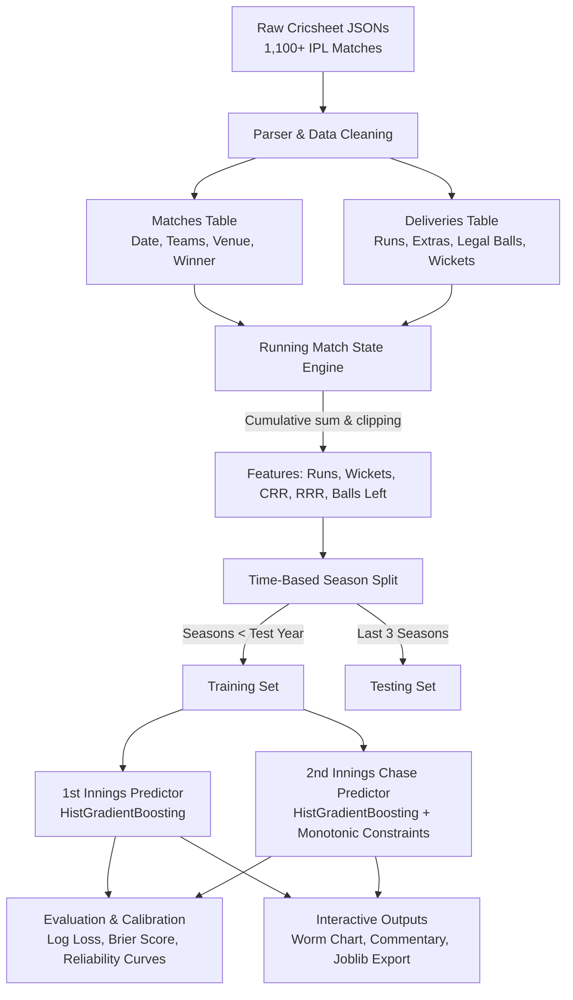

# 🏏 IPL Win Predictor (Ball-by-Ball Machine Learning)

[](https://www.python.org/)
[](https://scikit-learn.org/)
[](https://pandas.pydata.org/)
[](https://cricsheet.org/)
[](LICENSE)

An end-to-end Machine Learning project that predicts the real-time, ball-by-ball win probability of Indian Premier League (IPL) cricket matches — generating live win probability "worm" charts and over-by-over commentary (e.g., *"CSK 68% to win"*), similar to broadcast analytics engines.

Built from scratch using raw, nested JSON match event data from [Cricsheet](https://cricsheet.org/) covering **1,100+ IPL matches (2008–present)**.

---

## 📌 Project Overview

Unlike standard tabular datasets, cricket match data arrives as unstructured ball-by-ball event feeds. This project demonstrates:
1. **Hierarchical JSON Parsing:** Ingesting and transforming raw event logs (`match → innings → overs → deliveries`) into structured match-level and ball-level tables.
2. **Leak-Free Match-State Feature Engineering:** Formulating running situational metrics (`balls_left`, `wickets_left`, `crr`, `rrr`, `runs_needed`) without forward-looking data leakage.
3. **Time-Aware Model Validation:** Splitting train and test sets strictly across seasons (training on historical seasons, validating on recent seasons) rather than standard random row splitting.
4. **Domain-Constrained Probability Modeling:** Training calibrated probabilistic models (`HistGradientBoostingClassifier` with monotonic constraints & `LogisticRegression`).
5. **Leakage Forensics:** Hands-on demonstrations showing why random row-splitting and future-dependent features produce artificially inflated scores.
6. **Interactive Visualizations & Live Commentary:** Plotting dual-innings win-probability worm charts and querying arbitrary in-game scenarios.

---

## 🏗️ Architecture & Pipeline



---

## 📊 Features & Engineered Match States

### 1. In-Play Features
All features are computed incrementally per innings using running totals (`cumsum`) to guarantee that row $n$ only possesses information available up to ball $n$:

| Feature | Scope | Formula / Description |
|---|---|---|
| `runs_so_far` | Both Innings | Cumulative runs scored by the batting team so far |
| `wickets_left` | Both Innings | $10 - \text{wickets\_fallen}$ (clipped $[0, 10]$) |
| `legal_balls` | Both Innings | Count of valid deliveries (excludes wides & no-balls) |
| `balls_left` | Both Innings | $120 - \text{legal\_balls}$ (remaining balls in innings) |
| `crr` | Both Innings | Current Run Rate: $\frac{\text{runs\_so\_far} \times 6}{\max(1, \text{legal\_balls})}$ |
| `target` | Chase Only | 1st Innings total score $+ 1$ |
| `runs_needed` | Chase Only | $\max(0, \text{target} - \text{runs\_so\_far})$ |
| `rrr` | Chase Only | Required Run Rate: $\frac{\text{runs\_needed} \times 6}{\max(1, \text{balls\_left})}$ |

### 2. Domain-Informed Monotonic Constraints
To prevent decision trees from fitting noisy fluctuations in cricket data, monotonic directionality constraints are enforced:
- **`runs_needed` $(-1)$:** As runs required increase $\rightarrow$ win probability strictly decreases.
- **`balls_left` $(+1)$:** More balls remaining $\rightarrow$ win probability increases.
- **`wickets_left` $(+1)$:** More wickets in hand $\rightarrow$ win probability increases.
- **`rrr` $(-1)$:** Higher required run rate $\rightarrow$ win probability decreases.

---

## 🧪 Model Performance & Evaluation

Probability forecasting is evaluated using proper scoring rules:
- **Log Loss:** Penalizes overconfident incorrect predictions.
- **Brier Score:** Mean squared error of probabilities ($(\hat{p} - y)^2$). A constant 50% baseline scores `0.250`.
- **Reliability / Calibration:** Probability curves plotted against actual win frequency.

### Model Comparison (Chase Model)

| Model Configuration | Log Loss (↓) | Brier Score (↓) | Accuracy | Notes |
|---|---|---|---|---|
| **Baseline (50% uniform)** | 0.693 | 0.250 | 50.0% | Uninformative baseline |
| **Logistic Regression** | ~0.37–0.40 | ~0.11–0.13 | ~82–84% | Linear baseline with standard scaling |
| **HistGradientBoosting** | **~0.33–0.36** | **~0.10–0.11** | **~85–87%** | Non-linear tree boosting with monotonic rules |

### Accuracy Progression by Match Stage
Predictive certainty increases naturally as the innings progresses toward resolution:

| Match Phase | Legal Balls Bowled | Predictive Accuracy | Brier Score |
|---|---|---|---|
| **Overs 1–6 (Powerplay)** | Balls 1–36 | ~65–70% | ~0.18–0.20 |
| **Overs 7–12 (Middle Overs)** | Balls 37–72 | ~75–80% | ~0.14–0.16 |
| **Overs 13–16 (Setup Phase)** | Balls 73–96 | ~85–88% | ~0.08–0.10 |
| **Overs 17–20 (Death Overs)** | Balls 97–120 | ~93–97% | ~0.03–0.05 |

---

## 🚨 The Data Leakage Experiments

The repository includes explicit case studies illustrating two critical forms of data leakage in sports analytics:

1. **Target Leakage (`final_total`):**
   - Injecting the final 1st-innings total into early-over predictions creates artificially high performance (Log Loss ~0.15), but fails in production since the total cannot be known ahead of time.
2. **Row-Level Random Split Leakage:**
   - Performing `train_test_split` randomly on delivery rows places ball 40 of a match in train and ball 41 in test. The model memorizes match IDs and looks up outcomes, reporting inflated test accuracy that collapses on unseen matches.
   - **Remedy:** Grouped temporal splitting by season and match ID.

---

## 📈 Win Probability Worm Chart & Commentary

The notebook stitches both innings models into a continuous probability trajectory ($0 \rightarrow 40$ overs):

```
CSK vs RCB · 2024-03-22 · won by CSK
--------------------------------------------------
after over  1 (1st inns):  RCB  54% to win
after over  6 (1st inns):  CSK  58% to win
after over 15 (1st inns):  RCB  61% to win
after over 20 (1st inns):  CSK  52% to win
after over  5 (chase)   :  CSK  68% to win
after over 10 (chase)   :  CSK  81% to win
after over 18 (chase)   :  CSK  98% to win
Result: CSK won
```

---

## 🚀 Quickstart Guide

### Option 1: Run in Google Colab (Recommended)
1. Open [Google Colab](https://colab.research.google.com).
2. Click **File** $\rightarrow$ **Upload notebook** $\rightarrow$ Select `ipl_win_predictor.ipynb`.
3. Run all cells (`Runtime` $\rightarrow$ `Run all` or `Shift + Enter`).
4. The notebook downloads and unpacks Cricsheet data automatically.

### Option 2: Run Locally

#### 1. Clone the repository
```bash
git clone https://github.com/Sumant26/ipl-win-predictor-ml.git
cd ipl-win-predictor-ml
```

#### 2. Set up virtual environment
```bash
python -m venv venv
# On Windows (PowerShell):
.\venv\Scripts\Activate.ps1
# On Linux/macOS:
source venv/bin/activate
```

#### 3. Install dependencies
```bash
pip install pandas numpy scikit-learn matplotlib joblib jupyter
```

#### 4. Launch Jupyter Notebook
```bash
jupyter notebook ipl_win_predictor.ipynb
```

---

## 💻 Querying the Trained Model

You can query arbitrary match situations directly using the trained model:

```python
import joblib
import pandas as pd

# Load saved models
bundle = joblib.load("ipl_win_models.joblib")
chase_model = bundle["chase"]
features = bundle["chase_features"]

def predict_chase_win_prob(target, runs, wickets_fallen, overs_bowled):
    balls_bowled = int(overs_bowled) * 6 + round((overs_bowled % 1) * 10)
    balls_left = max(0, 120 - balls_bowled)
    runs_needed = max(0, target - runs)
    
    state = pd.DataFrame([{
        "runs_needed": runs_needed,
        "balls_left": balls_left,
        "wickets_left": 10 - wickets_fallen,
        "rrr": (runs_needed * 6) / max(1, balls_left),
        "crr": (runs * 6) / max(1, balls_bowled),
        "target": target,
    }])
    
    prob = chase_model.predict_proba(state[features])[0, 1]
    return prob

# Example scenario: Chasing 190, 120/3 after 14.0 overs
p = predict_chase_win_prob(target=190, runs=120, wickets_fallen=3, overs_bowled=14.0)
print(f"Chasing Team Win Probability: {p:.1%}")
```

---

## 📁 Repository Structure

```
05-ipl-win-predictor/
│
├── ipl_win_predictor.ipynb      # Main Jupyter notebook (data pipeline, modeling, eval, worm charts)
├── README.md                    # Comprehensive project documentation
└── ipl_win_models.joblib        # (Generated upon running) Exported serialized models
```

---

## 🔮 Future Enhancements

- [ ] **Venue Historical Priors:** Incorporate historical venue-specific average 1st-innings par scores.
- [ ] **Rolling Team Form:** Compute team-specific rolling Elo ratings or recent win rates.
- [ ] **Batter & Bowler Matchups:** Incorporate batter match-up strike rates and bowler economy indices.
- [ ] **Streamlit Web Application:** Interactive dashboard allowing live score inputs and real-time worm chart plotting.

---

## 📚 Acknowledgements & References

- Match data sourced from [Cricsheet.org](https://cricsheet.org/) (Open Data licensed under ODC-By).
- Built with [Scikit-Learn](https://scikit-learn.org/) and [Pandas](https://pandas.pydata.org/).

---

## 📄 License

This project is licensed under the MIT License - see the [LICENSE](LICENSE) file for details.
